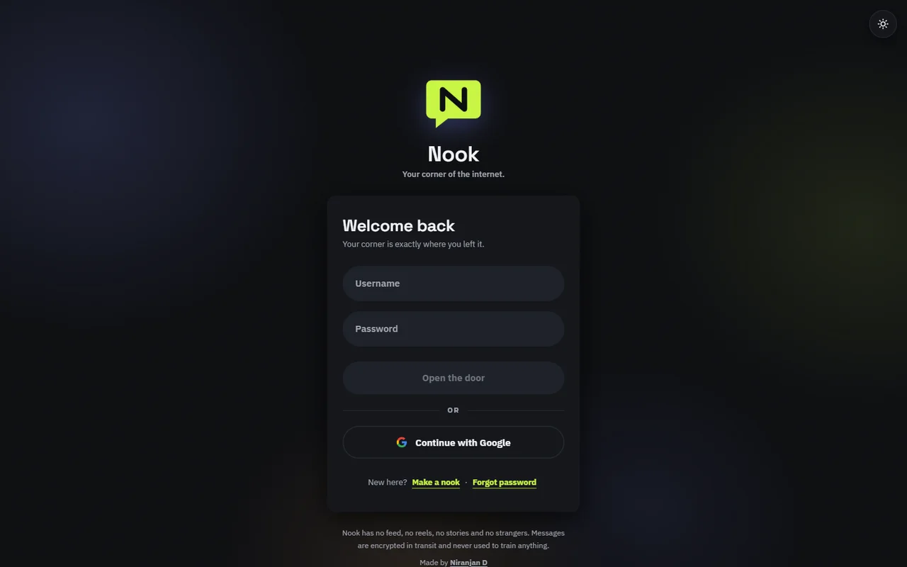
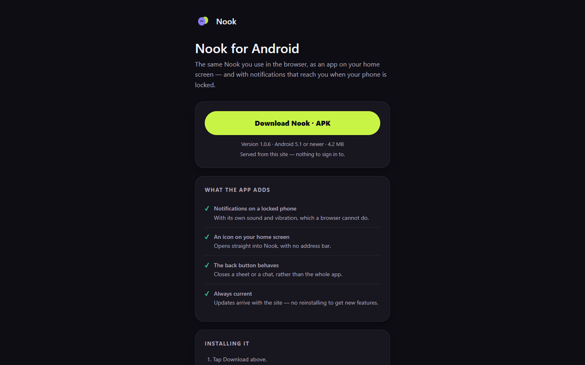

# Nook

**A private messenger for the few people you actually talk to.** No feed, no reels, no stories, no strangers, no algorithm.

[Open Nook](https://nook.niranjand.in) · [Download for Android](https://github.com/Niranjan266/Nook/releases/latest/download/nook.apk) · [Case study](https://www.niranjand.in/projects/nook)

<p align="center">
  
</p>

## What it is

Most messengers have slowly turned into feeds: stories, suggested contacts, and strangers who can message you. Nook goes the other way. It is a chat app for a small circle — text, photos, voice notes, snaps, disappearing messages and voice or video calls — where nobody can reach you until you have accepted them. It runs in any browser, installs as an app, and has an Android build that adds lock-screen notifications.

## Features

- **Messaging** — text with live links, photos, video, documents, voice notes with waveform scrubbing, reply-quote, forward to many, edit within 15 minutes, delete for me or unsend for everyone, stars, reactions, search, read receipts, typing indicators and presence.
- **Snaps** — a photo each recipient can open once plus three replays, then it is gone. Snaps cannot be forwarded.
- **Disappearing messages** — a timer per conversation that starts when the message is delivered, not when it was written.
- **Secret chats** — end-to-end encrypted conversations; the server only ever sees ciphertext.
- **Voice and video calls** — one-to-one WebRTC calls with ring screen, mute, camera toggle, minimise-to-pill, and a call log written back into the chat. Calls only ring between friends.
- **Wallpapers that belong to the conversation** — set an image and the bubbles are tinted to match it. In a direct chat the other person has to accept a new wallpaper before it changes for both of you.
- **Groups** — admins, add and remove, promote and demote, invite links, group wallpaper.
- **Rooms** — a mood, a wall you can pin notes to, a wallpaper that follows the time of day, and its history.
- **Little things** — send later, message reminders, polls, stickers, on-device voice-note transcription.
- **Works offline** — anything you send while disconnected waits in an outbox and is replayed in order when you reconnect.
- **Backups to your own Google Drive** — encrypted on your device with a password that never leaves it.
- **Everywhere** — installable PWA, Web Push with Reply and Mark-read actions, light, dark and system themes, keyboard navigation, and an Android app with native notifications.

## Screenshots

| Sign in | Android download page |
|---|---|
|  |  |

## How it works

```
                     ┌──────────────────────────────┐
  Browser / PWA ─────┤  client/  React + Vite (SPA) │──── Vercel (static)
  Android (Capacitor)┤  Zustand stores, IndexedDB   │
                     └──────────────┬───────────────┘
                     HTTPS (REST)   │   WebSocket (Socket.IO)
                                    ▼
                     ┌──────────────────────────────┐
                     │  server/  Express + Socket.IO│──── Render (Docker)
                     │  routes · sockets · services │
                     │  scheduler (in-process)      │
                     └──┬─────────┬────────┬────────┘
                        │         │        │
                 libSQL / Turso  Cloudinary  Web Push · FCM · mail
                 (SQLite file    (local-disk  (each optional, each
                  when unset)     fallback)    degrades gracefully)
```

The frontend is a static bundle on Vercel. The API is the always-listening half — Express, Socket.IO and WebRTC signalling — which is why it runs as a long-lived container on Render rather than as serverless functions: a function cannot hold a socket open between invocations.

### Real-time path

REST handles anything that must be durable (sending, editing, uploads); Socket.IO fans out the result plus everything ephemeral — typing, presence, receipts and call signalling. The server relays WebRTC offers, answers and ICE candidates, and before ringing anyone it checks that the callee is in the conversation, that neither person has blocked the other, and that they are friends. An unanswered call becomes a missed call after 40 seconds. ICE servers come from STUN plus optional TURN, with short-lived relay credentials from Cloudflare Realtime TURN when configured. If `REDIS_URL` is set, the Socket.IO Redis adapter lets more than one instance share rooms; without it the server runs single-instance.

### Time-based behaviour without a job queue

A small in-process scheduler (`server/src/services/scheduler.js`) does four jobs on a 20-second tick: deliver scheduled messages, sweep expired disappearing messages (SQLite has no TTL index, so this has to be explicit), apply per-conversation retention rules, and fire reminders. A scheduled message is *claimed* before delivery so a slow send can never be delivered twice, and its disappearing timer is pushed back by however late it went out. Messages someone chose to keep are never swept.

### Snaps

Each recipient gets one open plus three replays. The server records an open *before* returning the media, and deletes the file from storage only once every recipient has used all of their looks. Screenshots cannot be blocked in a browser, so the client blurs the snap when the window loses focus and tells the sender a screenshot may have happened — a courtesy, not a guarantee.

### Secret chats (end-to-end encryption)

Ordinary chats are encrypted in transit (TLS) and access-controlled at rest, but the server can read them. Secret chats are different, and the design is written out at the top of [`client/src/lib/e2ee/crypto.ts`](client/src/lib/e2ee/crypto.ts):

- **Identity** — each device has an ECDH P-256 identity key and an ECDSA P-256 signing key; only public halves are published.
- **Handshake** — the creator combines a fresh ephemeral key and its identity key with the partner device's identity key (two ECDH agreements through HKDF-SHA256), and signs a transcript binding the conversation, both devices and all keys. The ephemeral private key is discarded as soon as the chains exist.
- **Messages** — each direction is a symmetric hash ratchet. Every message gets a new AES-256-GCM key, with the conversation, sender device and counter bound in as associated data so a ciphertext cannot be replayed elsewhere.
- **What that buys** — forward secrecy per chain step: stealing a device's state today does not reveal messages already sent.
- **What it does not** — post-compromise security. There is no Diffie-Hellman ratchet, so the documented remedy for a suspected compromise is to start a new secret chat.

The crypto module has no imports beyond WebCrypto, so `npm run e2ee:selftest` runs the *shipped* module under Node rather than a copy. For secret chats the server stores only ciphertext and skips link previews, search and notification text. Keys live in IndexedDB, deliberately outside the cache that sign-out clears, and reads are never time-boxed to an empty fallback — a slow database that "returned nothing" would otherwise look like a fresh device and silently replace its identity.

### Backups

The client builds a backup, compresses it and seals it with a key derived from a password that never leaves the device. The server only moves the encrypted blob to the person's own Google Drive, using the `drive.appdata` scope — a hidden app folder, with no access to any other file.

### Android

The Android app is a Capacitor shell (`client/android/`) that loads the live site rather than a bundled copy. That keeps one origin for cookies, Google sign-in and CORS, and means every deploy reaches phones without a reinstall. Native plugins add what a browser cannot: Firebase Cloud Messaging notifications on a locked phone with their own sound and vibration, call audio routing, and a back button that closes a sheet instead of the app. The reasoning is in [docs/ANDROID.md](docs/ANDROID.md). A separate Expo / React Native client lives in `mobile/` and talks to the same API.

### Security and abuse model

- JWT access tokens plus a refresh cookie, bcrypt password hashes, zod-validated input, and rate limits on sign-in, verification and admin routes.
- "Membership is not consent": anything that writes something the other person will see (wall notes, mood, slow mode) is gated on an accepted relationship, so a stranger cannot use a direct conversation as a side channel.
- On-device voice transcription uses the browser's own speech recognition, so audio is not sent to a Nook server for reading.

### Running on free hosting

A free Render instance sleeps after 15 minutes without inbound traffic and drops every socket; a cold boot was measured at over 100 seconds. The server pings its own public URL every ten minutes (`server/src/services/keepAwake.js`), and a scheduled GitHub Action knocks as a backstop. Every third-party service — Turso, Cloudinary, mail, Web Push, FCM, TURN — degrades gracefully, so Nook runs and is fully usable with an empty `.env`.

### Testing

`server/test/run.sh` boots a real server on a throwaway SQLite database and runs 18 suites against it (security, snaps, secret chats, backup, push, polls, reminders, search and more) instead of mocking — most bugs lived in the seam between a route and a serialiser, which is exactly where a mock sits. GitHub Actions runs the server suites, a typecheck and production build of the web app, and a typecheck of the mobile app on every push.

## Tech stack

| Layer | Choices |
|---|---|
| Web client | React 18, TypeScript, Vite, Zustand, Framer Motion, socket.io-client, idb-keyval, hand-written CSS design system |
| Server | Node.js, Express, Socket.IO, libSQL / Turso, bcrypt, JWT, zod, express-rate-limit, multer, sharp (optional) |
| Real-time and calls | Socket.IO (optional Redis adapter), WebRTC, STUN, TURN (static or Cloudflare Realtime TURN) |
| Android | Capacitor 6 with native Java plugins, Firebase Cloud Messaging |
| Mobile (React Native) | Expo 52, Expo Router, React Native 0.76, Reanimated |
| Services | Cloudinary (local-disk fallback), Gmail API / Brevo / Resend for mail (console fallback), Web Push (VAPID), Google sign-in, Google Drive backups |
| Infrastructure | Vercel (web), Render via Docker blueprint (API), GitHub Actions (CI and keep-awake) |

## Getting started

**Prerequisites:** Node.js 22 (what CI and the server Dockerfile use) and npm. No database to install: with no Turso credentials the server writes to `server/data/nook.db`, a real SQLite file.

### Windows one-click scripts

| File | What it does |
|---|---|
| `Nook-Web.bat` | Starts the API and the web app, opens your browser |
| `Nook-Mobile.bat` | Starts the API and Expo, and points your phone at this computer |
| `Make-Keys.bat` | Generates JWT and push keys locally, for deployment |
| `Build-Android.bat` | Builds the Android app and publishes it — see [docs/MAKE-THE-APK.md](docs/MAKE-THE-APK.md) |
| `Make-Signing-Key.bat` | Creates the key that signs the app (once, before anyone else installs it) |
| `Gmail-Auth.bat` | Connects a Gmail account for sending mail (one time) |
| `Make-Admin.bat` | Creates the admin login hash |
| `Publish-Release.bat` | Publishes a built APK as a GitHub release |
| `Stop-Nook.bat` | Stops everything |

`Nook-Mobile.bat` finds the address your phone can reach this computer on and writes it to `mobile/.env` — `localhost` on a phone means the phone. It deliberately skips VirtualBox, WSL, Hyper-V and VPN adapters.

### By hand

```bash
npm run install:all      # installs server + client

npm run dev:server       # terminal 1 — http://localhost:4000
npm run dev:client       # terminal 2 — http://localhost:5173
```

Open http://localhost:5173.

### Demo data

```bash
npm run seed
```

Creates four demo accounts — `ada`, `river`, `kofi` and `mira`, all with the password `nookdemo1` — plus a direct chat and a group with history. Sign in as `ada` in one browser and `river` in a private window to watch real-time messaging, typing indicators, receipts and calls work.

### Tests and builds

```bash
cd server && bash test/run.sh          # all server suites (or: bash test/run.sh security)
cd client && npm run typecheck         # web typecheck
cd client && npm run build             # production build
cd client && npm run e2ee:selftest     # secret-chat crypto self-test
cd mobile && npm run typecheck         # React Native typecheck
```

For the React Native app: `cd mobile && npm install && npx expo start`, then scan the QR code with Expo Go. See [mobile/README.md](mobile/README.md).

### Configuration

Copy `server/.env.example` to `server/.env` and `client/.env.example` to `client/.env`. Everything is optional for local use. [docs/ENV-VARS.md](docs/ENV-VARS.md) explains what goes where — in particular, never prefix a secret with `VITE_`, because Vite pastes those values into the public bundle.

| Area | Server variables |
|---|---|
| Core | `PORT`, `NODE_ENV`, `CLIENT_ORIGIN`, `PUBLIC_URL`, `APP_URL`, `COOKIE_DOMAIN`, `ALLOW_VERCEL_PREVIEWS` |
| Auth | `JWT_ACCESS_SECRET`, `JWT_REFRESH_SECRET`, `ACCESS_TTL`, `REFRESH_TTL`, `GOOGLE_CLIENT_ID`, `GOOGLE_CLIENT_SECRET` |
| Database | `TURSO_DATABASE_URL`, `TURSO_AUTH_TOKEN` |
| Media | `CLOUDINARY_CLOUD_NAME`, `CLOUDINARY_API_KEY`, `CLOUDINARY_API_SECRET` |
| Mail | `MAIL_PROVIDER`, `GMAIL_CLIENT_ID`, `GMAIL_CLIENT_SECRET`, `GMAIL_REFRESH_TOKEN`, `GMAIL_SENDER`, `GMAIL_SENDER_NAME`, `BREVO_API_KEY`, `BREVO_SENDER_EMAIL`, `BREVO_SENDER_NAME`, `RESEND_API_KEY`, `RESEND_FROM` |
| Push | `VAPID_PUBLIC_KEY`, `VAPID_PRIVATE_KEY`, `VAPID_SUBJECT`, `FCM_SERVICE_ACCOUNT` |
| Calls | `STUN_URLS`, `TURN_URL`, `TURN_USERNAME`, `TURN_CREDENTIAL`, `CLOUDFLARE_TURN_KEY_ID`, `CLOUDFLARE_TURN_API_TOKEN` |
| Backups | `BACKUP_TOKEN_KEY` |
| Scaling and ops | `REDIS_URL`, `KEEP_AWAKE`, `ADMIN_USERNAME`, `ADMIN_PASSWORD_HASH`, `ADMIN_EMAILS` |

The web client reads only `VITE_API_URL` (and `VITE_API_TARGET` for the dev proxy).

### Guides

| Guide | Covers |
|---|---|
| [SETUP.md](docs/SETUP.md) · [KEYS.md](docs/KEYS.md) | Keys and first-time setup |
| [DEPLOY.md](docs/DEPLOY.md) · [RENDER-STEP-BY-STEP.md](docs/RENDER-STEP-BY-STEP.md) · [GO-LIVE.md](docs/GO-LIVE.md) | Deploying the API and web app |
| [GOOGLE-LOGIN-SETUP.md](docs/GOOGLE-LOGIN-SETUP.md) · [GMAIL-SETUP.md](docs/GMAIL-SETUP.md) · [BREVO-SETUP.md](docs/BREVO-SETUP.md) · [BACKUP-SETUP.md](docs/BACKUP-SETUP.md) | Google sign-in, mail and Drive backups |
| [ANDROID.md](docs/ANDROID.md) · [MAKE-THE-APK.md](docs/MAKE-THE-APK.md) | The Android app and building the APK |
| [DESIGN.md](docs/DESIGN.md) | The design system |
| [ROADMAP.md](docs/ROADMAP.md) · [ENCRYPTION-AND-LOCAL-FIRST.md](docs/ENCRYPTION-AND-LOCAL-FIRST.md) | Status, and specs for MLS group encryption and local-first sync |

## Project structure

```
Nook/
├── client/                 Web app (Vite + React + TypeScript)
│   ├── src/features/       auth · shell · chat · calls · sheets · admin
│   ├── src/stores/         Zustand: auth · chat · call · friends · stickers · ui
│   ├── src/lib/            api · socket · outbox · push · e2ee/ · backup/ · transcribe …
│   ├── src/styles/         tokens and materials of the design system
│   ├── public/             service worker, manifest, Android download page
│   ├── android/            Capacitor project and native plugins
│   └── scripts/            e2ee and backup self-tests
├── server/                 API (Express + Socket.IO + libSQL)
│   ├── src/routes/         auth · conversations · messages · rooms · spaces · calls · e2ee · backup …
│   ├── src/sockets/        connection, messaging, typing, presence, call signalling
│   ├── src/services/       scheduler · media · mail · push · fcm · turn · keepAwake …
│   ├── src/db/             schema.sql, migrations, data access
│   └── test/               18 integration suites + run.sh
├── mobile/                 Expo / React Native client
├── docs/                   setup, deployment, Android, design and roadmap guides
├── tools/                  key, icon and admin helpers
├── render.yaml             Render blueprint for the API
└── *.bat                   Windows one-click scripts
```

## Known limitations

- **Ordinary chats are not end-to-end encrypted** — only secret chats are. The server can read regular messages.
- **Group calls are not supported yet.** Calls are one-to-one; group calling needs a media server (SFU).
- **WebRTC needs TURN on strict networks.** STUN alone fails behind some NATs; set `TURN_URL` or the Cloudflare TURN variables in production.
- **Snap screenshots cannot be blocked** in a web app.

## Roadmap

From [docs/ROADMAP.md](docs/ROADMAP.md): eight of ten planned sections are built (rooms, anti-engagement, small touches, voice notes, media pipeline, scale and hardening, commercial features, and a deliberate "things to skip" list). Two are written up as specs rather than built: MLS-based end-to-end encryption for every chat, and local-first sync with CRDTs.

## Author

Built by Niranjan D — [niranjand.in](https://www.niranjand.in) · [GitHub](https://github.com/Niranjan266) · [LinkedIn](https://www.linkedin.com/in/niranjan266)
